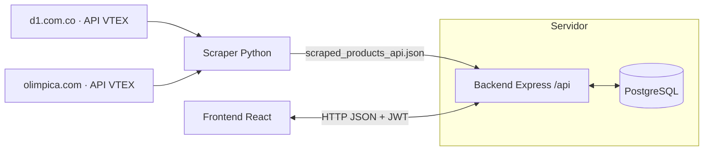
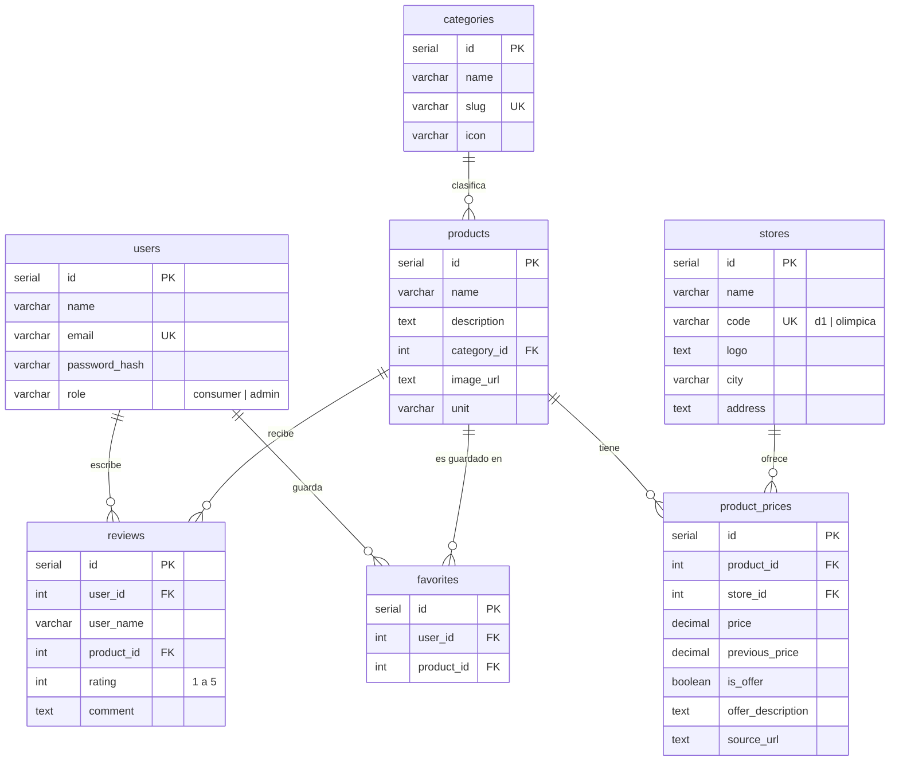

# SmartFoodPop — Documentación del proyecto

**Este es el único documento técnico del proyecto.** Reúne el alcance, la puesta en marcha, el diseño, las reglas para cambiar el código, las pruebas, las decisiones y el guion de la demo. Si cambias algo que aquí se describe, actualiza la sección correspondiente en el mismo cambio.

- **Fuente de verdad funcional:** `SmartFood Alcance Proyecto Software.docx.md`, el documento oficial de la asignatura *Construcción de Software*. Si este archivo y el alcance se contradicen, manda el alcance.
- **Para agentes de IA:** lee primero la [sección 1](#1-reglas-para-cambiar-el-código-léelas-antes-de-tocar-nada). Lo que no esté en el alcance no se implementa sin decisión del equipo (sección 6.2 del alcance).

## Contenido

1. [Reglas para cambiar el código](#1-reglas-para-cambiar-el-código-léelas-antes-de-tocar-nada)
2. [Qué es y qué incluye](#2-qué-es-y-qué-incluye)
3. [Puesta en marcha](#3-puesta-en-marcha)
4. [Arquitectura](#4-arquitectura)
5. [Modelo de datos](#5-modelo-de-datos)
6. [API e interfaz](#6-api-e-interfaz)
7. [Trazabilidad: requisitos → código → pruebas](#7-trazabilidad-requisitos--código--pruebas)
8. [Pruebas](#8-pruebas)
9. [Decisiones registradas](#9-decisiones-registradas)
10. [Límites conocidos](#10-límites-conocidos)
11. [Guion de la demostración](#11-guion-de-la-demostración)

---

## 1. Reglas para cambiar el código (léelas antes de tocar nada)

### 1.1 Antes de escribir código

1. **¿Está en el alcance?** Ubica el cambio en un RF/HU (sección 7). Si no corresponde a ninguno, o choca con lo excluido (compras, domicilios, garantizar disponibilidad física, login con Google/Facebook), **detente y pregunta**.
2. **¿Ya existe?** Busca primero en `backend/src/services`, `backend/src/domain`, `frontend/src/hooks` y `frontend/src/utils`. Extiende lo que hay; no crees un segundo servicio, hook o utilidad que haga lo mismo.
3. **¿Rompe un contrato?** Mantén las rutas, los payloads y los códigos HTTP de la sección 6. Si un contrato debe cambiar, cambia también el frontend (`frontend/src/api/*`), las pruebas y esta documentación.
4. **Basa tus respuestas en evidencia.** Cita archivos reales. Si algo no está definido en el código ni en el alcance, dilo y pide confirmación; no lo inventes.

### 1.2 Stack permitido (restricción 7.1 del alcance)

React (Vite) · Node.js + Express · PostgreSQL · Python para el scraping · GitHub. El equipo aprobó TypeScript para el backend y el frontend el 26-nov-2026. La migración empezó por el backend y continúa por grupos en el frontend. Esta decisión actualiza el stack de trabajo respecto a la sección 7.1 del alcance original. Cualquier otra dependencia o tecnología nueva requiere justificarla y que el equipo la apruebe.

### 1.3 Principios

- **Capas con una sola responsabilidad (SOLID).** Ruta → middleware → controlador → servicio → repositorio → persistencia. Las validaciones de negocio van en los **servicios**, no en los controladores.
- **Inyección de dependencias.** Todo se construye en `backend/src/container.ts` (*composition root*). Un servicio recibe sus colaboradores por constructor; nunca hace `require` de otro servicio ni crea repositorios por su cuenta.
- **Dominio puro.** `backend/src/domain/` no hace E/S: recibe datos y devuelve datos. Ahí va la lógica que se puede probar sin servidor.
- **KISS / YAGNI.** Elige la solución más simple que cumpla el criterio de aceptación. Nada de abstracciones «por si acaso».
- **Bajo acoplamiento.** Si añadir una función obliga a modificar código no relacionado que ya funcionaba, repórtalo antes de seguir.
- **Errores.** Los servicios lanzan `httpError(status, mensaje)` (`domain/httpError.ts`) o `AuthError`. La API siempre responde `{ "error": "mensaje" }` con el código adecuado (400, 401, 403, 404, 409).
- **Frontend.** Los componentes usan los hooks (`hooks/`) y las llamadas a la API pasan por `api/httpClient.ts`. La interfaz muestra lo que **el servidor confirmó**: nada de datos simulados ni actualizaciones optimistas que no se reviertan.
- **Interfaz accesible.** Botones con `aria-label` cuando solo tienen icono, diálogos con `role="dialog"`/`alertdialog` y mensajes de estado visibles (carga, error, vacío).
- **Cada cambio con su prueba.** Un comportamiento nuevo lleva prueba en la suite que corresponda (sección 8). Prioriza los casos límite sobre las pruebas redundantes.

### 1.4 Dónde va cada cosa

| Quiero… | Dónde |
|---|---|
| Un endpoint nuevo | `routes/<recurso>.ts` (URL, verbo y middlewares) → `controllers/<recurso>Controller.ts` (HTTP ↔ servicio) → método en un servicio existente o uno nuevo registrado en `container.ts` → montarlo en `app.ts` |
| Una regla de negocio o validación | En el servicio del caso de uso (`services/`) |
| Lógica de catálogo (nombres, tamaños, categorías, emparejamiento) | `domain/productNormalizer.ts`, `productClassifier.ts`, `catalogBuilder.ts`, `productEquivalence.ts` |
| Un filtro de búsqueda | `domain/productFilters.ts` (servidor) y `frontend/src/utils/filterProducts.ts` (cliente). Mantén ambos coherentes. |
| Guardar algo nuevo en la base | `data/schema.sql` (con `IF NOT EXISTS`), el contrato en `data/persistence.ts`, un método en `data/PostgresPersistence.ts` y su equivalente en `NoopPersistence`; el repositorio llama a la persistencia |
| Una llamada nueva desde el frontend | `frontend/src/api/<recurso>Api.ts` → hook en `hooks/` → componente |
| Un componente visual | `frontend/src/components/<área>/`; los estilos compartidos están en `index.css` (clases `nav-btn`, `modal-content`, `product-card`, …) |
| Una tienda o fuente nueva del scraper | `scraper/config.py` + `scraper/sources/` (VTEX en `vtex.py`); debe producir el mismo DTO (sección 4.4) |

### 1.5 Invariantes: no los rompas

Cada uno corrige un defecto real que ya ocurrió (ver la sección 8.4).

- **Contraseñas** siempre con hash bcrypt (`PasswordHasher.js`). No existe recuperación de contraseña: la que había permitía tomar cualquier cuenta.
- **Rutas `/api/admin/*`** exigen el rol `admin`: 401 sin token y 403 con un rol distinto.
- **Eliminar un producto** borra en cascada sus precios, reseñas y favoritos, y en la interfaz **pide confirmación**.
- **Editar un producto** en el panel conserva sus ofertas.
- **Categorías:** solo las cuatro del alcance: *Granos y básicos, Lácteos, Aseo del hogar, Otros*. **Tiendas:** solo D1 y Olímpica (Popayán).
- **Comparación:** dos ofertas son «el mismo producto» solo si coinciden en contenido neto y tienen nombre similar. Nunca compares 500 g contra 5 kg como si fueran iguales; para presentaciones distintas usa el **precio por kg/L**.
- **El catálogo público** solo lista productos comparables (sección 4.3).
- **Los ids de los productos son estables.** La actualización del scraper es incremental (`domain/catalogRefresh.ts`): reseñas y favoritos nunca se pierden por actualizar precios.
- **Si una tienda trae menos del 50 % de los productos que tenía** (`MIN_STORE_RATIO`), se conservan sus precios anteriores. Si el scraper no obtiene casi nada, no sobrescribe el JSON.
- **Enlaces «Ver en la tienda»:** siempre `https://<tienda>/<slug>/p` (`domain/productUrl.ts`). Sin el `/p`, VTEX muestra un 404 o una búsqueda vacía.
- **Un JSON mal formado** en la petición responde 400, nunca 500.
- **Secretos** fuera del repositorio: `backend/.env` y `scraper/cookies/` están en `.gitignore`.

### 1.6 Antes de terminar un cambio

```bash
npm test                                       # backend + frontend
npm --prefix backend run typecheck             # verificación de tipos del backend
npm --prefix frontend run typecheck            # verificación de tipos del frontend
npm run lint && npm run build                  # frontend
cd scraper && python -m unittest discover -s tests   # si tocaste el scraper
```

Si el cambio es visual, pruébalo en el navegador con `npm run dev -- --no-scrape` y añade el paso a la lista manual (sección 8.3).

---

## 2. Qué es y qué incluye

Aplicación web que centraliza productos, precios, ofertas y reseñas de **Tiendas D1** y **Supermercado Olímpica** en **Popayán**, para comparar precios y comprar de forma informada.

| Incluido (alcance 6.1) | Excluido (alcance 6.2 y 7.1) |
|---|---|
| Registro e inicio de sesión con correo y contraseña · Catálogo · Búsqueda y filtros · Detalle · Reseñas y calificaciones · Ofertas · Comparación de precios · Productos guardados · Panel del administrador | Comprar en la web · Domicilios · Garantizar que una oferta esté disponible físicamente · Login con Google o Facebook |

**Actores:** el *consumidor* consulta, compara, guarda y reseña; el *administrador* agrega, edita y elimina productos.

| Capa | Tecnología |
|---|---|
| Frontend | React 19 + Vite con el código de aplicación en TypeScript estricto y módulos ESM. Los iconos usan `lucide-react`. |
| Backend | Node.js 20+ + Express, JWT, bcryptjs, `pg`. Todo el código de aplicación en `backend/src/` usa TypeScript estricto y se compila a CommonJS. |
| Base de datos | PostgreSQL (en memoria si no está configurada; solo para desarrollo) |
| Scraping | Python 3.10+ con `requests` contra la API de VTEX de cada tienda |

---

## 3. Puesta en marcha

```bash
npm run install:all                     # dependencias del backend y del frontend
npm run db:setup                        # crea la base "smartfoodpop" y escribe backend/.env (pide la clave de PostgreSQL)
npm run db:check                        # ✔ Conectado a la base "smartfoodpop"
npm run dev                             # backend :5000 + frontend (Vite) + scraper en segundo plano
npm run dev -- --no-scrape              # igual, sin actualizar precios (rápido, sin internet)
npm --prefix backend run build         # compila src/ a dist/ y copia el esquema SQL
npm --prefix backend start             # ejecuta el backend compilado
```

En desarrollo, el backend compila y vigila `src/`, y Node reinicia el servidor cuando cambia el código compilado. `dist/` conserva la estructura de `src/` y lleva `data/schema.sql`. El backend compilado busca `.env` en `backend/` y sigue leyendo el JSON del scraper desde su ubicación original o desde `SCRAPED_PRODUCTS_PATH`. Si se modifica el SQL durante el desarrollo, reinicia el comando de desarrollo para volver a copiarlo.

El scraper necesita `python -m pip install -r scraper/requirements.txt`.

### 3.0 En un equipo nuevo (Windows): `git clone` + `start.bat`

**Requisitos:** [Node.js](https://nodejs.org) 20.19 o superior (LTS). Recomendados: [PostgreSQL](https://www.postgresql.org/download/) encendido y [Python](https://www.python.org) 3.10 o superior.

```bat
git clone https://github.com/Cfelipe23/SmartFoodPopv2.git
cd SmartFoodPopv2
start.bat
```

`start.bat` (también con doble clic) prepara todo y arranca:

1. Comprueba Node.js y su versión.
2. Instala las dependencias del backend si falta el compilador TypeScript o los tipos de sus bibliotecas, y las del frontend si falta su carpeta `node_modules`.
3. Si hay Python, instala `scraper/requirements.txt` cuando falte `requests`. Sin Python, la app usa los precios guardados.
4. Si no existe `backend/.env`, configura PostgreSQL **automáticamente** (`npm run db:setup`): busca el servidor en los puertos 5432–5434 y pide **una sola vez** la contraseña del usuario `postgres`, la que se eligió al instalar PostgreSQL. Esa clave no se puede automatizar porque solo la conoce quien lo instaló. Admite 3 intentos; luego crea la base `smartfoodpop` y escribe `backend/.env`, que no se sube a git. Las tablas y el catálogo los crea el backend al arrancar. Si PostgreSQL no está instalado o está apagado (detecta el servicio de Windows y explica cómo iniciarlo), la app arranca **en memoria** y en el siguiente arranque lo vuelve a intentar.
5. Ejecuta `node run-dev.js`, que levanta el backend en `:5000`, el frontend en la URL «Local» que muestra Vite (normalmente `:5173`) y el scraper en segundo plano. Acepta los mismos argumentos (`start.bat --no-scrape`).

Lo que viene en el repositorio basta para funcionar sin internet: `scraper/output/scraped_products_api.json` trae el último catálogo. Lo que **no** viene, y se genera en cada equipo: `node_modules/`, `backend/.env` y `scraper/cookies/` (las crea el scraper). Verificado con un clon limpio el 25-nov-2026.

### 3.1 Variables de entorno (`backend/.env`, plantilla en `backend/.env.example`)

| Variable | Uso |
|---|---|
| `DATABASE_URL` (o `PGHOST`/`PGPORT`/`PGUSER`/`PGPASSWORD`/`PGDATABASE`) | PostgreSQL. **Sin ella el backend funciona en memoria**, los datos se pierden al reiniciar y la página muestra un aviso amarillo. Los caracteres especiales de la clave van codificados (`@` → `%40`). |
| `JWT_SECRET` | Obligatoria con `NODE_ENV=production`. |
| `PORT` | 5000 por defecto. |
| `SEED_USER_PASSWORD`, `SEED_ADMIN_PASSWORD` | Contraseñas de las cuentas demo. |
| `RESEED_CATALOG=true` | Reconstruye el catálogo desde cero: conserva las cuentas, pero **borra reseñas y favoritos**. Casi nunca hace falta. |
| `SCRAPED_PRODUCTS_PATH` | Otra ruta para el JSON del scraper. |
| `SCRAPE_ON_START=false`, `PYTHON=...` | Para `run-dev.js`: omitir el scraper o indicar otro intérprete de Python. |

Sin `db:setup`: crea la base `smartfoodpop` en pgAdmin y copia `.env.example` a `.env` con tu `DATABASE_URL`. Las tablas se crean solas. Con Docker: `docker run -d --name smartfood-pg -e POSTGRES_USER=smartfood -e POSTGRES_PASSWORD=smartfood -e POSTGRES_DB=smartfoodpop -p 5432:5432 postgres:16-alpine`. Si la conexión falla, el backend no arranca y explica la causa.

### 3.2 Cuentas de demostración

| Rol | Correo | Contraseña (desarrollo) |
|---|---|---|
| Consumidor | `usuario@popayan.com` | `user123` |
| Administrador | `admin@smartfood.com` | `admin123` |

Se guardan con hash. Los botones de acceso rápido del login solo aparecen en desarrollo.

### 3.3 Scraper

`npm run scrape` (o `cd scraper && python scraper.py`) genera `scraper/output/scraped_products_api.json` y deja la versión anterior como `.json.bak`. Una ejecución completa tarda unos **18 minutos**. `npm run dev` lo lanza en cada arranque: la app abre de inmediato con los últimos precios guardados y, cuando el scraper termina (`[SCRAPER ] Listo`), el backend carga los precios nuevos sin reiniciarse; basta con recargar la página. `python scraper/verify.py` muestra un resumen del JSON.

---

## 4. Arquitectura



### 4.1 Backend (`backend/src`)

| Capa | Carpeta | Contenido |
|---|---|---|
| Rutas | `routes/` | `auth`, `products`, `reviews`, `favorites`, `admin`. Cada una recibe su controlador y el middleware. |
| Middleware | `middleware/authMiddleware.ts`, `errorMiddleware.ts` | Verificación JWT, autorización por rol y respuesta central de errores. La solicitud lleva un usuario opcional. |
| Controladores | `controllers/` | Traducen HTTP ↔ servicio y serializan errores. |
| Servicios | `services/` | Módulos TypeScript `AuthService` (+ `PasswordHasher`, `TokenService`, `AuthError`), `ProductService` (listado y ofertas), `ProductDetailService`, `ProductComparisonService`, `ProductAdminService`, `ReviewService`, `FavoriteService`, `CatalogRefreshService`. |
| Dominio | `domain/` | `entities.ts` define entidades, presentaciones, equivalencias y el resultado de actualización. Los módulos TypeScript `productNormalizer`, `productClassifier`, `catalogBuilder`, `productEquivalence`, `catalogRefresh`, `productFilters`, `queryHelpers`, `productUrl`, `imageResolver` y `httpError` contienen la lógica pura. |
| Contratos | `contracts/` y `data/postgresRows.ts` | `scraper.ts` comprueba registros del JSON, `api.ts` describe entradas y respuestas HTTP, y `postgresRows.ts` describe las proyecciones SQL antes de convertir decimales y fechas. |
| Repositorios | `repositories/` | Clases TypeScript `ProductRepository`, `CatalogRepository` (tiendas y categorías), `UserRepository`, `ReviewRepository` y `FavoriteRepository`. Leen de memoria y delegan la escritura al contrato `Persistence`. |
| Datos | `data/` | `schema.sql`, `PostgresPersistence.ts`, `persistence.ts` (`Persistence`, `CatalogPersistence` y `NoopPersistence`), `inMemoryStore.ts`, `initialData.ts` (tiendas, categorías y cuentas demo), `scrapedProductsLoader.ts`. |
| Composición | `container.ts`, `app.ts`, `config/env.ts` | `buildContainer`, `bootstrapContainer`, configuración del entorno y montaje de Express. |
| Scripts | `backend/scripts/` | `setup-db.js` y `check-db.js`. Sus comandos npm compilan el backend y cargan la persistencia desde `dist/`. |

### 4.2 Persistencia y arranque

1. `bootstrapContainer` crea el esquema si no existe. Si la base ya tiene catálogo, lo carga en memoria y aplica el JSON más reciente del scraper (actualización incremental). Si es el primer arranque, construye el catálogo desde el JSON y lo guarda.
2. **Las lecturas** se sirven desde memoria. **Las escrituras** (usuarios, reseñas, favoritos, productos) se encolan en orden hacia PostgreSQL. Por eso hay una sola instancia del backend (sección 10).
3. `server.ts` carga `backend/.env` antes de evaluar la configuración, vigila el JSON del scraper (`CatalogRefreshService.watch`) y aplica los cambios.

### 4.3 Construcción del catálogo (RF03, RF07, RF08)

1. `productNormalizer`: normaliza el nombre (tildes, mayúsculas), extrae el contenido neto (`2.500 G`, `1,1 Lt X6`) en g o ml × unidades y separa las palabras significativas.
2. `productClassifier`: asigna una de las cuatro categorías del alcance.
3. `catalogBuilder`: une en una tarjeta el **mismo producto** de D1 y Olímpica (mismo contenido neto y similitud de nombre ≥ 0,6) y genera el detalle de la oferta («Antes $X · ahorras N %»).
4. `productEquivalence`: para los productos que solo están en una tienda busca el **equivalente** más parecido en la otra (misma unidad de medida, similitud ≥ 0,5) y calcula el precio por kg/L.
5. `ProductService.list` expone **solo los productos comparables**: primero los idénticos, luego los que tienen equivalente.
6. `catalogRefresh.mergeCatalog`: reconoce cada producto por la URL de su página en cada tienda; actualiza precios, añade los nuevos y retira los que ya no se publican. No toca los productos creados por el administrador.

### 4.4 Scraper (`scraper/`)

| Archivo | Función |
|---|---|
| `scraper.py` | Punto de entrada: recorre las fuentes, valida y escribe. |
| `config.py` | Tiendas, categorías y parámetros. |
| `sources/vtex.py`, `base.py`, `category_tree.py`, `session_provider.py` | Cliente VTEX: paginación, reintentos y cookies regionales de Popayán (en `scraper/cookies/`, fuera de git). |
| `query_builder.py` | Deriva unas 400 búsquedas para Olímpica a partir de los productos de D1, para que haya con qué comparar. |
| `writer.py` | Escritura atómica (`.tmp` → JSON) con respaldo `.bak`. |

D1 se consulta con su catálogo completo (alimentos y aseo del hogar). De Olímpica solo se conserva la sección *Supermercado*. El JSON exporta `name`, `price`, `original_price`, `store` (`d1` u `olimpica`), `is_offer`, `offer_desc`, `image_url`, `source_url`, `scraped_at` y `sku_id`. El lector acepta campos opcionales ausentes o nulos en archivos anteriores. El backend deduce la presentación del nombre, normaliza el enlace a `/p` y obtiene `previous_price` a partir de `original_price` y del precio vigente.

### 4.5 Frontend (`frontend/src`)

| Elemento | Archivos |
|---|---|
| Arranque y composición | `main.tsx` monta `App.tsx` dentro de `StrictMode` y `AuthProvider`. `App.tsx` coordina las pestañas de catálogo, ofertas y guardados, los filtros, la paginación de 24 en 24, los modales y los avisos. |
| Componentes | `layout/Header.tsx` (buscador, pestañas, menú de perfil), `layout/HeroBanner.tsx`, `products/ProductCard.tsx`, `products/ProductDetailModal.tsx` (detalle, comparativa, favoritos y reseñas), `auth/AuthModal.tsx`, `admin/AdminPanel.tsx`, `common/Toast.tsx` |
| Estado | `context/AuthContext.tsx` proporciona la sesión tipada por `context/authContext.ts`. `hooks/useAuth.ts` consume el contexto. `useProducts.ts` gestiona catálogo y acciones administrativas, `useProductDetail.ts` el producto seleccionado y `useFavorites.ts` los guardados por usuario. |
| API | `api/httpClient.ts` añade el token, normaliza los errores y cierra la sesión si el token caduca. Los módulos `authApi`, `productApi`, `reviewApi`, `favoriteApi`, `adminApi` y `healthApi` validan las respuestas con `responseGuards.ts`. |
| Sesión | `storage/sessionStorage.ts` conserva las claves `smartfood_token` y `smartfood_user` en `localStorage`. |
| Utilidades | `utils/filterProducts.ts` (búsqueda, filtros y orden de ofertas), `comparison.ts` (comparativa por tarjeta), `format.ts` (pesos colombianos y descuentos), `productPayload.ts` (validación del formulario del administrador) |

`types/api.ts` reexporta solo tipos de los contratos HTTP y entidades que usa el backend. `types/presentation.ts` define las formas que necesitan las utilidades y el formulario. Ante un cambio de API, actualiza el contrato en el backend y su validación en `responseGuards.ts`, y comprueba ambos con el cliente y una respuesta real. Las referencias de tipos se eliminan del bundle y el chequeo necesita esos archivos del repositorio.

El proveedor restaura el usuario local y escucha el evento de caducidad emitido por el cliente HTTP. Cada lectura de detalle queda asociada al identificador seleccionado y su efecto descarta respuestas tras un cambio de selección. Los cambios administrativos y de favoritos requieren una respuesta que confirme la operación antes de actualizar el estado.

El build del frontend ejecuta `tsc` antes de Vite. La configuración de aplicación usa `strict`, `noEmit`, `react-jsx`, resolución `bundler` y `allowJs: false`. Las pruebas en JavaScript se ejecutan por separado con `node:test`. El punto de entrada conserva la extensión explícita en el import de `AuthContext.tsx` para distinguirlo de `authContext.ts` en Windows.

### 4.6 Seguridad

Contraseñas con bcrypt (coste predeterminado 10) · JWT HS256 de 7 días en `Authorization: Bearer` · autorización por rol en `/api/admin/*` · `JWT_SECRET` obligatorio en producción · autenticación propia, sin proveedores externos.

---

## 5. Modelo de datos

PostgreSQL, definido en `backend/src/data/schema.sql`.



Reglas: el correo es único; hay un precio por producto y tienda (`UNIQUE (product_id, store_id)`) y un favorito por usuario y producto; la calificación va de 1 a 5 (`CHECK`). Al borrar un producto se borran en cascada sus precios, reseñas y favoritos. `users`, `products`, `reviews` y `favorites` tienen `created_at`; `product_prices`, `updated_at`.

---

## 6. API e interfaz

### 6.1 API REST (`http://localhost:5000/api`)

| Método y ruta | Acceso | RF | Respuesta |
|---|---|---|---|
| `GET /` | Público | — | 200 con `{app, city, version, status, endpoints}` |
| `POST /auth/register` | Público | RF01 | `{name,email,password}` → 201 con `{user, token, message}` · 400 por validación · 409 si el correo existe |
| `POST /auth/login` | Público | RF02 | `{email,password}` → 200 con `{user, token, message}` · 400 por campos vacíos · 401 «Credenciales incorrectas» |
| `GET /auth/me` | Usuario | RF02 | 200 con `{user}` a partir del JWT verificado |
| `GET /products` | Público | RF03, RF04, RF09 | 200 con `{products, stores, categories, total, message}`. Consultas `search`, `category`, `store`, `is_offer` · 400 por parámetro inválido |
| `GET /products/offers` | Público | RF08 | 200 con `{total, offers}` |
| `GET /products/compare` | Público | RF07 | 200 con `{total, products, message}` y precio mínimo, máximo y ahorro potencial por producto. Consultas `search`, `category`, `store` · 400 por parámetro inválido |
| `GET /products/:id` | Público | RF05–RF07 | 200 con `{product, reviews, review_summary, similar}` · 404 si el ID no corresponde a un producto |
| `GET /reviews/product/:productId` | Público | RF06 | 200 con `{reviews}`, lista vacía si no hay coincidencia |
| `POST /reviews` | Usuario | RF06 | `{product_id, rating, comment}` → 201 con `{review, message}` · 400 por validación · 404 si el producto no existe |
| `GET /favorites` | Usuario | RF10 | 200 con `{favorites}` |
| `POST /favorites/toggle` | Usuario | RF10 | `{product_id}` → 200 con `{isFavorite, message}` · 400 si falta el ID · 404 si el producto no existe |
| `POST /admin/products` | Admin | RF11 | `{name, category_id, prices, description?, unit?, image_url?}` → 201 con `{product, message}` · 400 por validación |
| `PUT /admin/products/:id` | Admin | RF11 | Cuerpo parcial del alta → 200 con `{product, message}` · 400 por validación · 404 si el producto no existe |
| `DELETE /admin/products/:id` | Admin | RF11 | 200 con `{message}` · 404 si el producto no existe |
| `GET /health` | Público | — | 200 con `{status, storage: "postgres" \| "memory"}` |

Express aplica CORS y luego el lector JSON. En rutas protegidas, `authenticateToken` devuelve 401 si falta el token y 403 si es inválido o expiró. En rutas de administración, `requireAdmin` se ejecuta después y devuelve 403 si falta el rol `admin`. El preflight de CORS responde 204. Una ruta desconocida bajo `/api` devuelve 404. Los errores JSON llevan `{error}`. El manejador central devuelve 400 para JSON mal formado y 500 para otros errores inesperados, con un mensaje genérico.

### 6.2 Pantallas

| Elemento | HU | Contenido |
|---|---|---|
| Página principal | HU03, HU04, HU09 | Buscador, filtros por categoría y tienda, tarjetas paginadas y estados de carga, error y vacío |
| Tarjeta de producto | HU03, HU07, HU08, HU10 | Precio por tienda, equivalente en la otra tienda con precio por kg/L, mejor opción, insignia de oferta y corazón para guardar |
| Detalle (modal) | HU05–HU07, HU10 | Características, botón «Guardar producto», comparativa por tienda con «Ver en la tienda», productos similares y reseñas con su formulario |
| Pestaña Ofertas | HU08 | Ordenadas por mayor descuento; mensaje si no hay ofertas |
| Guardados (pestaña o menú de perfil) | HU10 | Productos guardados; se pueden quitar |
| Ingreso / Registro (modal) | HU01, HU02 | Validación y mensajes de confirmación o error; la sesión queda iniciada al registrarse |
| Panel del administrador (modal) | HU11 | Formulario, listado con buscador, edición y eliminación con confirmación |

---

## 7. Trazabilidad: requisitos → código → pruebas

Todos los criterios de aceptación de HU01 a HU11 están implementados (revisión del 25-nov-2026).

| RF / HU | Sprint (alcance) | Dónde está | Pruebas |
|---|---|---|---|
| RF01 / HU01 Registro | 1 | `AuthModal` → `AuthService.register`: campos obligatorios, correo válido, contraseña de 6 caracteres o más, correo único, bcrypt, mensaje y sesión iniciada | `api.test.js` HU01, `solid.test.js`, `postgres.test.js` |
| RF02 / HU02 Inicio de sesión | 1 | `AuthService.login` + JWT; la sesión caducada se cierra sola | `api.test.js` HU02 |
| RF03 / HU03 Catálogo | 1 | Scraper → `scrapedProductsLoader`/`catalogRefresh` → `GET /products` → `App.tsx` | `api.test.js` HU03, `catalog.test.js`, `catalogRefresh.test.js`, `scraper/tests/*` |
| RF04 / HU04 Búsqueda | 2 | `Header` + `utils/filterProducts.ts` (sin recargar, ignora tildes); API `?search=` | `api.test.js`, `utils.test.js` RF04 |
| RF05 / HU05 Detalle | 2 | `ProductDetailModal` / `ProductDetailService` | `api.test.js` HU05, `solid.test.js` RF05 |
| RF06 / HU06 Reseñas | 2–3 | `ReviewService`: lectura pública y publicación solo con sesión | `api.test.js` HU06, `postgres.test.js` |
| RF07 / HU07 Comparación | 1 (matriz) | `catalogBuilder`, `productEquivalence`, `utils/comparison.ts` | `catalog.test.js` HU07, `equivalence*.test.js`, `comparison.test.js` |
| RF08 / HU08 Ofertas | 3 | Pestaña Ofertas y `GET /products/offers` | `api.test.js`, `catalog.test.js` HU08, `utils.test.js` RF08 |
| RF09 / HU09 Filtros | 2–3 | Categoría y tienda, combinables; mensaje si no hay coincidencias | `api.test.js`, `solid.test.js` RF09, `utils.test.js` RF09 |
| RF10 / HU10 Guardados | 3 | Corazón en la tarjeta y botón en el detalle; lista desde la pestaña y el menú de perfil | `api.test.js` HU10, `utils.test.js` RF10, `postgres.test.js` |
| RF11 / HU11 Administrador | 3 | `AdminPanel` + `ProductAdminService`: solo admin, validación, confirmación, mensajes y cambios inmediatos | `api.test.js` HU11, `utils.test.js` HU11 |

---

## 8. Pruebas

### 8.1 Suites

| Nivel | Herramienta | Dónde |
|---|---|---|
| Unitarias (servicios, dominio, sustitución de dependencias) | `node:test` | `backend/tests/solid.test.js`, `catalog.test.js`, `catalogRefresh.test.js`, `equivalence.test.js`, `equivalence-quality.test.js`, `domainContracts.test.js` |
| Integración HTTP (servidor Express real, una sección por HU) | `node:test` + `fetch` | `backend/tests/api.test.js` y `backend/tests/httpBoundary.test.js` |
| Persistencia | `node:test` + `pg-mem` y pool simulado. Persistencia compilada verificada también en PostgreSQL 18.6 aislado. | `backend/tests/postgres.test.js`, `backend/tests/persistenceContracts.test.js` |
| Autenticación | `node:test` con bcrypt y JWT | `backend/tests/authContracts.test.js` y los casos de autenticación de `api.test.js` |
| Frontend (filtros, comparación, formato, formulario, HTTP, sesión y hooks) | `node:test` con el cargador de Vite y ReactDOM Server para el estado inicial y las acciones de los hooks | `frontend/src/utils/*.test.js`, `frontend/src/api/httpClient.test.js`, `frontend/src/context/authContext.test.js` y `frontend/src/hooks/*.test.js` |
| Scraper (contrato, paginación, reintentos, categorías, búsquedas, URL) | `unittest` | `scraper/tests/` |
| Estáticas | `tsc`, `oxlint`, `vite build` | `npm --prefix backend run typecheck`, `npm --prefix frontend run typecheck`, `npm run lint`, `npm run build` |

Las pruebas del backend ejecutan el código compilado en `dist/`. Las de persistencia usan `pg-mem`.

### 8.2 Última ejecución (25-nov-2026)

Backend 54/54 · Frontend 11/11 · Scraper 19/19 · lint sin avisos · build correcto.

Migración del dominio (26-nov-2026) · Backend 58/58 · chequeo de tipos y build correctos. La comparación antes y después con una copia fija del JSON incluyó productos, precios, ofertas, categorías, equivalencias y actualización con cobertura parcial.

Migración de persistencia y repositorios (26-nov-2026) · Backend 60/60 · chequeo de tipos y build correctos. Las dos pruebas nuevas cubren el mapeo de filas y el orden de la cola tras un rollback.

Migración de servicios (26-nov-2026) · Backend 62/62 · chequeo de tipos y build correctos. Antes de migrar se verificaron el esquema, las conversiones, el orden de escritura, el rollback, el cierre, el reinicio y la fusión de productos en un clúster PostgreSQL 18.6 temporal.

Migración HTTP (26-nov-2026) · Backend 64/64 · chequeo de tipos y build correctos. La comparación antes y después con una muestra fija cubrió los 16 endpoints explícitos y 54 casos HTTP con la misma huella de respuestas.

Con Node.js 20.19.0 en Windows se verificaron el build desde `dist/` vacío, `start.bat --no-scrape`, `npm start`, el cliente HTTP del frontend y la recarga del catálogo desde una copia de prueba.

Migración de API, sesión y utilidades del frontend (26-nov-2026) · Frontend 15/15 · backend 64/64 · chequeo de tipos, lint y build correctos. La integración usó Express compilado en memoria y una muestra fija. Se verificaron catálogo, filtros, detalle, comparación, ofertas, sesión, reseñas, favoritos y administración.

Migración de hooks y contexto (26-nov-2026) · Frontend 23/23, con chequeo de tipos, lint y build correctos · backend 64/64 con chequeo de tipos correcto. La integración combinó HTTP contra Express en memoria con una muestra fija y renderizado de `App.jsx` y `ProductCard.jsx` mediante ReactDOM Server. La comprobación visual y de efectos en navegador quedó pendiente por un fallo de acceso a Chrome.

Migración de componentes (26-nov-2026) · Frontend 23/23 y backend 64/64 en Windows con Node.js 20.19.0 y 24.14.0. Pasaron el chequeo de tipos y la compilación de ambos, además del lint del frontend. Nueve escenarios produjeron HTML idéntico antes y después con ReactDOM Server y una muestra fija servida por Express en memoria. El build limpio no contiene módulos del backend ni credenciales de demostración.

Chrome con un perfil temporal verificó el catálogo, los filtros, las ofertas, el detalle comparativo, el registro, el inicio y el cierre de sesión, la caducidad del token, las reseñas, los favoritos y las operaciones administrativas. No registró errores de JavaScript. Las capturas de escritorio coincidieron y el tamaño del contenido móvil fue el mismo antes y después.

### 8.3 Aceptación manual en el navegador (no automatizada)

1. La portada muestra tarjetas con nombre, precio y tienda, y **no** aparece el aviso amarillo de base de datos.
2. Registro con un correo nuevo: confirmación y sesión iniciada. Con el mismo correo: «ya está registrado».
3. Contraseña incorrecta: mensaje de credenciales incorrectas.
4. Buscar «arroz» y luego «fríjol» o «frijol»: resultados sin recargar.
5. Filtrar por categoría y por tienda; si no hay coincidencias aparece un mensaje.
6. Detalle de «Arroz Diana 500 G»: comparativa, «mejor opción», «Ver en la tienda» abre la página del producto y se ven las reseñas.
7. Publicar una reseña: confirmación y aparece en la lista.
8. Guardar con el corazón de la tarjeta y con «Guardar producto» en el detalle; abrir el menú de perfil → «Mis productos guardados»; quitar uno.
9. Ofertas: insignia, precio tachado y porcentaje.
10. Como administrador: editar (mensaje y cambio inmediato), crear, y eliminar (diálogo de confirmación).
11. Reiniciar el backend: usuarios, reseñas, guardados y cambios del administrador siguen ahí. En pgAdmin se ven las 7 tablas.

### 8.4 Defectos corregidos (no los reintroduzcas)

| Defecto | Corrección |
|---|---|
| Un import equivocado de `AuthError` tumbaba el servidor ante un correo duplicado o una clave incorrecta | Exportación doble y uso correcto en `authController` |
| `POST /auth/reset-password` cambiaba la clave de cualquier cuenta | Ruta y pantalla eliminadas (no están en el alcance) |
| Contraseñas demo en texto plano | bcrypt en todas las cuentas |
| Los datos solo vivían en memoria | Persistencia en PostgreSQL con cola ordenada |
| No se notaba cuando la base no estaba configurada | Aviso en pantalla, `/api/health`, `db:check` y `db:setup` |
| El panel borraba sin confirmar y perdía las ofertas al editar | Diálogo de confirmación y edición que conserva las ofertas |
| 807 de 1.028 productos caían en «Granos y básicos» | Clasificador con las categorías del alcance |
| Variantes distintas (500 g y 5 kg) se fusionaban en una tarjeta | Emparejamiento por contenido neto y precio por kg/L |
| Solo 17 tarjetas tenían precio en ambas tiendas | Equivalentes y búsquedas de Olímpica derivadas de D1 |
| El frontend usaba datos simulados y silenciaba los errores | Datos confirmados por el servidor y estados de carga, error y vacío |
| El scraper traía colchones y electrodomésticos de Olímpica | Filtro por sección *Supermercado* |
| «Ver en la tienda» abría una página vacía | URL `…/{slug}/p` |
| Los precios solo cambiaban al reconstruir el catálogo, y eso borraba reseñas | Actualización incremental al terminar el scraper |
| HU10: no se podía guardar desde el detalle ni ir a los guardados desde el perfil | Botón en el detalle y menú de perfil |

---

## 9. Decisiones registradas

**Regla:** solo se añade una decisión aquí cuando el equipo o el usuario la **confirma**. Formato: fecha · decisión · motivo · sección del alcance · estado.

| Decisión | Motivo | Alcance |
|---|---|---|
| 26-nov-2026 · Migrar a TypeScript, primero el backend · Aprobada | Incorporar tipado estricto de forma gradual y mantener CommonJS durante la migración del backend | 7.1 |
| Catálogo en memoria con escritura diferida a PostgreSQL | Lecturas rápidas y servicios simples; basta con una instancia (proyecto académico) | 7.1 |
| Emparejar por contenido neto y similitud de nombre; equivalentes por kg/L | Comparar sin mezclar presentaciones distintas | RF07 |
| El catálogo público solo muestra productos comparables | El propósito es comparar entre tiendas | 2.4, RF07 |
| Búsqueda y filtros en el cliente, con los mismos filtros en la API | Nueva búsqueda sin recargar (criterio 5 de HU04) | RF04, RF09 |
| Sin recuperación de contraseña | No está en el alcance y la versión anterior era insegura | 7.1 |
| Scraper en cada `npm run dev` con actualización incremental | Precios al día sin perder reseñas ni favoritos | RF03 |
| Solo D1 y Olímpica; cuatro categorías | Definido en el alcance (2.4 y 8) | 2.4, 8 |

---

## 10. Límites conocidos

- **Cobertura:** de unos 4.100 productos del scraper, cerca de 1.010 son comparables y se muestran; el resto no tiene contraparte en la otra tienda. Un producto que crea el administrador con una sola tienda y sin equivalente no aparece en el catálogo.
- **Vigencia:** los precios son los del último scraping (campo `scraped_at` del JSON). No se garantiza que estén disponibles en la tienda física (excluido del alcance).
- **Una sola instancia del backend:** las escrituras se encolan desde la memoria del proceso.
- Si se cambia de cuenta mientras se guarda un favorito, la respuesta de la cuenta anterior puede hacer que la lista actual quede temporalmente vacía. El hook sigue filtrando los favoritos por el identificador del usuario activo.
- En la prueba de Chrome con una pantalla móvil de 390 px, el contenido ocupa 398 px tanto en la versión JSX como en la versión TSX.
- **Direcciones de las tiendas** en `data/initialData.ts`. Son de referencia y deben verificarse antes de presentarlas como reales.
- **Comparación por peso frente a unidad:** algunos productos que se venden por peso en una tienda y por unidad en la otra (p. ej. *Aguacate Hass Unidad*) dan diferencias de precio enormes.
- **Inconsistencias del documento de alcance** (por corregir en el documento, no en el código): las fichas HU tienen vacío «Requerimiento asociado» y sin marcar la prioridad; el título de RF10 está repetido; HU11 falta en la sección 13; la numeración de criterios es irregular en HU01 y HU11; los sprints de HU07, HU09 y HU11 y los puntos de HU11 difieren entre la ficha, la matriz y el backlog; RF04 dice «buscar y filtrar» en la priorización; RF06 dice «aplicación» en lugar de «publicación».

---

## 11. Guion de la demostración

Dura de 10 a 12 minutos. **Ensaya antes:** los precios cambian en cada `npm run dev`; si quieres precios fijos, arranca con `--no-scrape`. Guíate por el **nombre** de los productos, no por su id.

**Antes de empezar:** PostgreSQL encendido y `npm run db:check` en verde; `npm run dev`; sin aviso amarillo; pgAdmin abierto en las 7 tablas; mejor registrar una cuenta en vivo.

| # | Acción | HU |
|---|---|---|
| 1 | Portada: centraliza D1 y Olímpica y solo muestra los ~1.000 productos comparables | HU03 |
| 2 | Registrarse; repetir con el mismo correo | HU01 |
| 3 | Cerrar sesión; clave incorrecta; luego la correcta | HU02 |
| 4 | Buscar `arroz`, luego `fríjol` y `frijol` | HU04 |
| 5 | Filtrar por **Lácteos** y por **Olímpica** | HU09 |
| 6 | **Arroz Diana 500 G**, **Azúcar Blanca 1000 Grs** y **Arroz Integral Diana 1.000 G** (aquí gana la otra tienda) | HU07 |
| 7 | **Arroz Diana 10 Kg**: equivalente y comparación por kg; **Detergente líquido**: por litro | HU07 |
| 8 | Abrir el detalle → **Ver en la tienda** | HU05 |
| 9 | Publicar una reseña con sesión; sin sesión no se puede | HU06 |
| 10 | Pestaña **Ofertas** | HU08 |
| 11 | Guardar desde la tarjeta y desde el detalle → menú de perfil → **Mis productos guardados** → quitar uno | HU10 |
| 12 | Como administrador: editar un precio, crear un producto, eliminar uno (con confirmación) | HU11 |
| 13 | Reiniciar el backend y recargar: todo sigue ahí (PostgreSQL) | RNF |

**Si preguntan:** no todo se compara porque los surtidos y las marcas propias son distintos; si el scraper falla, se conservan los últimos precios (y queda el `.bak`); compras y domicilios están fuera del alcance (6.2).
